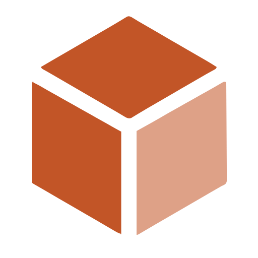
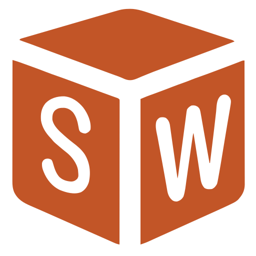
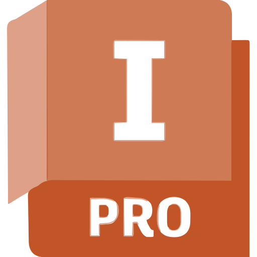
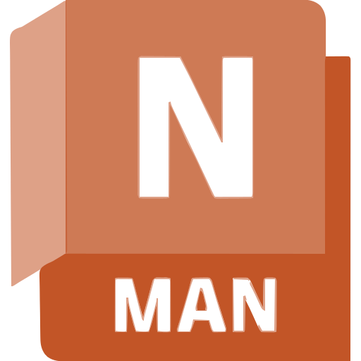
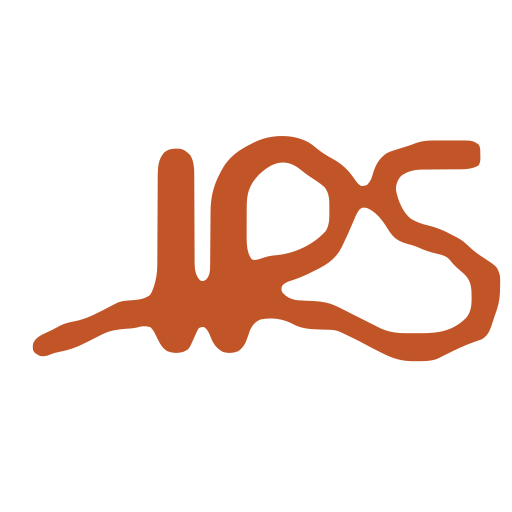

<h1 align="center">Oi, Luiz Zamban aqui !</h1>
<h3 align="center">Engenheiro de Manufatura Virtual</h3>
<h4 align="center">Simulações | Análise de dados | Virtualização </h3>

  
  

<fieldset style="border: 2px solid #F82A94; border-radius: 10px; padding: 20px; max-width: 800px;">
  <legend align="left"><h3>Sobre Mim</h3></legend>

  <em>
Eu sou um engenheiro ajudando a transformar ideias em processos de produção mais eficientes, antes mesmo delas chegarem à fábrica.
No dia a dia, uso ferramentas 3D e 2D, digital mockups, simulação de fluxo discretos e validação de layouts para apoiar decisões de manufatura.
Também gosto de conectar manufatura e dados: desenvolvo pipelines ETL e automatizo processos com RPAs e Scripts.

  </em> 
   

<b><i>Tecnologias</i></b> 

 
  

   <kbd>
    <kbd>CAD & CAE</kbd>
     
     
    
    
    
    
    
    
    
    
    
  </kbd>
  <kbd>
    <kbd>Game Dev</kbd>
     
     
     
     
    
    
    
    
  </kbd>
  <kbd>
    <kbd>Analise de dados</kbd>
     
     
    
    
    
  </kbd>
  <kbd>
    <kbd>Outros</kbd>
     
     
    
     
    
  </kbd>
   

  

 
 

- Contato: **luizczamban@gmail.com**

 
